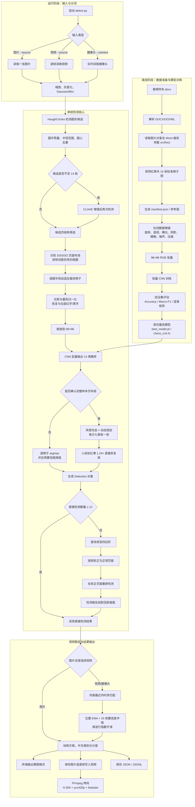

# 象棋棋子光电目标识别：程序流程与核心技术解析

## 一、系统总体设计

本项目不是单纯使用神经网络完成全部任务，也不是使用 YOLO 一类端到端目标检测模型，而是采用以下混合技术路线：

> 传统视觉定位 + CNN 棋子分类 + 固定页面结构约束 + 视频时序稳定

系统首先使用 OpenCV 在画面中定位圆形棋子，再将每个棋子裁剪并交给轻量 CNN 判断类别；识别完整样本页时，继续利用赛方页面固定布局和“每方七类各一枚”的规则纠正局部误判；处理视频和实时摄像头时，最后通过时序跟踪减少方框及置信度抖动。

## 二、程序整体流程图



## 三、项目代码结构

| 文件 | 主要职责 |
|---|---|
| [`chess_recognition/prepare_data.py`](chess_recognition/prepare_data.py) | 从 DOCX 提取数据并生成增强预览 |
| [`chess_recognition/train.py`](chess_recognition/train.py) | 训练、验证、早停并保存最佳模型 |
| [`chess_recognition/evaluate.py`](chess_recognition/evaluate.py) | 测试原始棋子分类和整页检测效果 |
| [`chess_recognition/detect.py`](chess_recognition/detect.py) | 图片、视频和摄像头检测入口及结果保存 |
| [`chess_recognition/chessvision/docx_extract.py`](chess_recognition/chessvision/docx_extract.py) | 解析 DOCX、图片关系和 Word 裁剪参数 |
| [`chess_recognition/chessvision/augment.py`](chess_recognition/chessvision/augment.py) | 数据增强、尺寸统一和张量归一化 |
| [`chess_recognition/chessvision/dataset.py`](chess_recognition/chessvision/dataset.py) | 构建动态增强训练集和原始精确测试集 |
| [`chess_recognition/chessvision/model.py`](chess_recognition/chessvision/model.py) | 定义轻量 CNN 及模型加载逻辑 |
| [`chess_recognition/chessvision/detection.py`](chess_recognition/chessvision/detection.py) | 圆检测、预处理、CNN 分类和版面约束 |
| [`chess_recognition/chessvision/tracker.py`](chess_recognition/chessvision/tracker.py) | 视频目标匹配、方框平滑和置信度稳定 |
| [`chess_recognition/chessvision/render.py`](chess_recognition/chessvision/render.py) | 绘制方框、中文标签和棋子数量 |
| [`chess_recognition/chessvision/labels.py`](chess_recognition/chessvision/labels.py) | 定义红黑 14 类棋子、名称和分值 |
| [`chess_recognition/chessvision/metrics.py`](chess_recognition/chessvision/metrics.py) | 计算准确率、精确率、召回率和 Macro-F1 |

## 四、离线数据准备流程

### 4.1 从 DOCX 精确提取棋子

DOCX 文件本质上是 ZIP 压缩包。程序读取以下内容：

- `word/document.xml`：图片对象及其在文档中的排列顺序；
- `word/_rels/document.xml.rels`：图片关系编号与真实图片文件路径；
- `a:srcRect`：Word 中为图片设置的上、下、左、右裁剪比例。

程序不是直接使用 DOCX 中未经裁剪的图片文件，而是按照 Word 的 `srcRect` 参数还原文档中实际显示的棋子区域。这样可以确保训练源与赛方文档显示内容完全一致。

提取后生成：

```text
data/base/                 14 张标准棋子图片
data/manifest.json         类别及图片信息
data/manifest.csv          CSV 格式类别信息
data/reference_sheet.jpg   14 类参考图
data/augmentation_preview.jpg  数据增强预览
```

棋子对象的顺序必须与 `labels.py` 中的 14 个类别顺序完全一致。

### 4.2 单样本动态扩增

每一类只有一张 DOCX 源图，因此训练集不是大量人工拍摄图片，而是在 `Dataset.__getitem__()` 中实时随机生成。

根据 `config.json`，每轮包含：

```text
训练集：14 类 × 300 张 = 4200 个动态样本
验证集：14 类 × 60 张 = 840 个动态样本
输入尺寸：96×96
```

扩增手段包括：

- 随机缩放和平移；
- ±22° 随机旋转；
- 随机透视变换；
- 亮度、对比度和 Gamma 变化；
- RGB 通道增益，模拟白平衡和打印偏色；
- 渐变阴影；
- 局部高光和反光；
- 高斯模糊；
- 随机噪声；
- JPEG 压缩失真。

扩增的目的不是生成新的棋子字体，而是模拟同一份打印材料在不同距离、角度、曝光、阴影、摄像头清晰度和视频压缩条件下的外观。

## 五、CNN 模型结构

模型接收 `3×96×96` 的 RGB 图像，输出 14 个类别的 logits。

```text
输入：3×96×96
  ↓
ConvBlock 3→32，空间尺寸 96→48
  ↓
ConvBlock 32→64，空间尺寸 48→24
  ↓
ConvBlock 64→128，空间尺寸 24→12
  ↓
ConvBlock 128→192，空间尺寸 12→6
  ↓
AdaptiveAvgPool2d(1)
  ↓
Flatten：192
  ↓
Linear：192→128
  ↓
SiLU + Dropout
  ↓
Linear：128→14
```

每个 `ConvBlock` 的结构为：

```text
3×3 卷积 → BatchNorm → SiLU
3×3 卷积 → BatchNorm → SiLU
2×2 MaxPool
```

模型采用轻量结构的原因是：系统每一帧需要同时分类 14 枚棋子，模型过大会降低实时摄像头帧率；96×96 输入已经足以表示棋子内部汉字笔画。

## 六、模型训练技术

训练阶段使用：

- `CrossEntropyLoss` 多类别交叉熵；
- `0.02` 标签平滑，降低模型过度自信；
- AdamW 优化器；
- CosineAnnealingLR 余弦退火学习率；
- CUDA 自动混合精度；
- Macro-F1 作为最佳模型选择依据；
- 连续 8 轮 Macro-F1 不提升时早停。

训练时模型输出原始 logits，损失函数直接处理 logits；只有在推理阶段才使用 Softmax 将 logits 转换为 14 类概率。

训练完成后保存：

```text
models/best_model.pt              PyTorch 检查点
models/chess_cnn.ts               TorchScript 模型
models/best_confusion_matrix.csv  最佳验证混淆矩阵
models/exact_confusion_matrix.csv 原始 14 图混淆矩阵
models/training_history.json      训练历史
models/training_curves.png        损失和指标曲线
models/training_report.json       最终训练报告
```

## 七、棋子定位：Hough 圆检测

CNN 只能判断一张裁剪图属于哪种棋子，并不知道棋子在完整画面中的位置，因此程序首先使用 OpenCV Hough 圆检测定位棋子。

处理步骤为：

1. 将过大的图像缩放到最长边不超过 1600 像素；
2. 转为灰度图；
3. 使用 GaussianBlur 降低噪声；
4. 使用 `cv2.HoughCircles()` 查找圆；
5. 将圆心及半径映射回原图尺寸；
6. 根据圆质量、半径和圆心距离过滤候选。

圆半径范围根据画面短边自动设置：

```text
最小半径：约为短边的 3.5%
最大半径：约为短边的 12%
```

### 7.1 圆质量评分

每个候选圆会计算质量分数：

```text
质量分数 = 0.55 × 外圈黑色比例
         + 0.25 × 内部笔画比例
         + 0.20 × 圆外浅色比例
```

该评分利用了棋子的典型结构：

- 外圈应存在连续深色圆环；
- 圆内部应存在汉字笔画；
- 圆外通常是浅色纸张背景。

程序还会根据所有候选圆的中位半径过滤过大、过小的异常圆，并删除圆心过近的重复候选。

### 7.2 CLAHE 回退检测

当质量筛选后的圆少于 14 枚时，程序对灰度图使用 CLAHE 局部对比度增强，再以更低的 Hough 累加器阈值重新检测。

CLAHE 只用于寻找圆，不会修改送入 CNN 的彩色原图，因此不会破坏偏暗红色墨迹的颜色信息。

## 八、棋子裁剪与光照归一化

### 8.1 自适应裁剪范围

棋子裁剪范围根据检测半径动态调整：

```text
远距离小目标：约 1.48× 半径，保留更多圆外留白
高分辨率大目标：约 1.13× 半径，保留更多汉字细节
80～140 像素半径之间：线性过渡
```

这种设计解决了训练图和现实拍摄图在目标占比上的差异。

### 8.2 红黑墨色判断

程序计算棋子内部暗色前景相对浅色背景的红色增量：

```text
红色增量 = 前景的 R-(G+B)/2
          - 背景的 R-(G+B)/2
```

这种相对颜色判断可以抵消暖色灯光和摄像头白平衡造成的整体偏色。

### 8.3 曝光与颜色标准化

程序使用灰度分位数估计背景和墨迹：

```text
82% 灰度分位：纸张背景
4% 灰度分位：最深墨迹
```

随后将现实画面重新映射为：

```text
纸张背景 → 接近白色
黑方墨迹 → 标准深黑色
红方墨迹 → 标准红色
```

这是系统能够抵抗曝光变化、阴影、暖色照明和打印红色偏暗的主要原因之一。

## 九、固定页面结构约束

赛方样本页固定排列为：

```text
第 1 行：3 枚
第 2 行：3 枚
第 3 行：3 枚
第 4 行：3 枚
第 5 行：2 枚
```

程序将候选圆按纵坐标聚类成 `3/3/3/3/2` 五行，再在每行中按横坐标排序。

页面结构用于：

1. 排除圆心间距明显异常的假圆；
2. 根据页面位置提供红黑阵营先验；
3. 约束红方和黑方各包含七种不同棋子。

选择 14 枚候选圆时，评分同时考虑：

- 圆本身的质量；
- 14 枚棋子的半径一致性；
- 每行三枚棋子的左右间距是否接近。

这可以排除横跨“相”和“馬”等相邻棋子的异常大圆。

## 十、动态规划全局唯一分类

CNN 为每一枚候选棋子输出 14 类概率。如果直接对每枚棋子独立取最大概率，可能产生以下问题：

```text
同一页面出现两个“炮”
缺少“馬”
模糊时炮、馬、相之间发生局部混淆
```

完整样本页已知每方七类各一枚，因此程序使用位图动态规划寻找全局最大似然分配。

优化目标为：

```text
最大化所有棋子所选类别的累计对数概率
```

同时满足：

```text
黑方 7 枚棋子的类别互不重复
红方 7 枚棋子的类别互不重复
候选类别必须属于已确认的阵营
```

这相当于把“单棋子局部判断”提升为“整张页面联合判断”，显著降低了某一帧局部模糊造成的错误。

对于已经确认的完整样本页，程序不使用普通单目标置信度阈值直接丢弃棋子，而是依靠圆形、阵营、页面布局和类别唯一性共同确定结果。

## 十一、红車小目标复核

实验发现：

- 炮类在带更多留白的 `1.48×` 裁剪下更稳定；
- 红車的细密笔画在远距离下会因留白过多而被压缩得过小。

因此程序先完成正常的 14 类批量分类，再对满足以下条件的红車进行一次复核：

```text
首轮全局分配结果为红車
候选圆半径小于 140 像素
```

复核时使用 `1.24×` 的紧裁剪。每帧只额外分类一枚棋子，计算量远低于对全部 14 枚棋子做多尺度推理。

## 十二、纸张透视校正

如果直接检测结果少于 12 枚，程序启动透视校正回退流程：

1. 灰度化和 GaussianBlur；
2. Canny 边缘检测；
3. 形态学闭运算连接纸张边缘；
4. 寻找面积足够大的轮廓；
5. 使用多边形近似筛选凸四边形；
6. 按左上、右上、右下、左下顺序排列四个角点；
7. 计算透视变换矩阵；
8. 使用 `warpPerspective()` 将斜拍纸张校正为正视图；
9. 在校正图上重新检测；
10. 使用逆透视矩阵将检测框映射回原画面。

直接检测结果已经足够时不会执行该步骤，因此不会无条件增加每帧计算量。

## 十三、视频时序跟踪与稳定

图片模式直接输出当前帧检测结果；视频和摄像头模式会额外使用 `TemporalTracker`。

### 13.1 同类目标匹配

已有轨迹只和类别相同的新检测进行匹配，匹配条件为：

```text
圆心距离 < 1.4 × 两者较大的半径
```

满足条件的候选中选择距离最近者。

### 13.2 检测框平滑

检测框、圆心、半径和圆质量使用指数移动平均：

```text
平滑系数 α = 0.35
```

这样可以减少 Hough 圆心在相邻帧间的微小抖动，同时保持方框对摄像头运动的响应速度。

### 13.3 轨迹生命周期

```text
min_hits = 2：连续出现两帧后才显示
max_misses = 5：最多允许丢失五帧
显示条件：当前连续丢失不超过两帧
```

因此视频第一帧通常不会显示检测框，这是为了过滤单帧误检，并非程序漏检。

### 13.4 置信度平滑

置信度使用两级稳定策略：

1. 取最近 15 帧置信度的中位数，过滤单帧尖峰和短时运动模糊；
2. 对中位数结果再使用 `0.25` 系数的指数平滑，避免滑动窗口过半时产生阶跃。

检测框的位置仍主要跟随当前帧，置信度平滑不会让方框明显滞后。

## 十四、结果绘制与保存

### 14.1 图片模式

图片模式输出：

```text
带方框和中文标签的标注图片
包含完整检测信息的 JSON 文件
终端识别结果
```

### 14.2 视频和摄像头模式

连续视频模式输出：

```text
逐帧标注视频
逐帧 JSONL 检测记录
终端识别结果
```

JSON/JSONL 中保存：

- 检测框坐标；
- 圆心和半径；
- 类别索引；
- 红黑阵营；
- 棋子名称；
- 分值；
- 分类置信度；
- 圆质量分数。

### 14.3 视频编码流程

OpenCV 首先将标注帧写入临时 MP4V 视频，正常结束后再调用 FFmpeg 转换为：

```text
容器：MP4
编码：H.264 High Profile
像素格式：yuv420p
CRF：20
网页优化：faststart
```

摄像头模式应在显示窗口中按 `q` 正常退出，以便程序执行：

```text
释放摄像头
关闭 VideoWriter
关闭 JSONL 文件
执行 H.264 转码
删除 MP4V 临时文件
```

如果直接关闭终端或使用 `Ctrl+C` 强制终止，可能只留下隐藏的 `.mp4v-temporary.mp4` 文件。

## 十五、三种输入模式的区别

| 模式 | 输入 | 是否逐帧 | 是否使用跟踪器 | 输出 |
|---|---|---:|---:|---|
| 图片 | JPG、PNG 等 | 否 | 否 | 标注图片 + JSON |
| 视频 | MP4 等 | 是 | 是 | 标注视频 + JSONL |
| 摄像头 | `/dev/videoN` | 是 | 是 | 实时窗口 + 标注视频 + JSONL |

三种模式共用同一个 `ChessRecognizer.detect()` 单帧检测核心，因此模型、圆检测、预处理和版面约束逻辑保持一致。

## 十六、系统主要优点

1. **训练数据来源符合赛题要求**：训练和测试都以赛方 DOCX 为数据源。
2. **少样本可训练**：通过针对现实拍摄条件的数据增强扩充 14 张源图。
3. **定位与分类职责分离**：Hough 圆负责位置，CNN 负责类别。
4. **利用已知赛题规则**：固定版面与每方七类唯一约束可以纠正局部误判。
5. **光照鲁棒性较强**：加入数据增强和推理阶段墨色归一化。
6. **视频输出稳定**：检测框和置信度均使用时序平滑。
7. **计算量较低**：轻量 CNN 可使用 CUDA 实时推理。
8. **结果可追溯**：视频之外还保留逐帧 JSONL 数据。

## 十七、适用范围与限制

该系统解决的是：

> 赛方 DOCX 中固定的 14 类棋子，在不同拍摄角度、距离、曝光、阴影和视频压缩条件下的闭集识别问题。

系统目前依赖以下先验：

- 棋子外形近似圆形；
- 测试页面主要使用赛方给出的固定棋子；
- 完整样本页采用 `3/3/3/3/2` 布局；
- 每方七种棋子各出现一枚；
- 打印时没有改变样本尺寸和版面结构。

如果改为以下场景，需要重新训练或调整检测逻辑：

- 完全不同字体的实体木质棋子；
- 非圆形棋子；
- 棋盘上的任意数量和任意排列；
- 同类棋子同时出现多枚；
- 页面排版发生改变；
- 目标严重遮挡或只露出部分圆环。

## 十八、程序核心思想总结

整个系统可以概括为：

> 用 Hough 圆找到棋子，用 CNN 识别汉字，用固定页面结构纠正单棋子误判，再用时序跟踪消除视频抖动。

从工程角度看，系统将传统计算机视觉、深度学习、赛题业务规则和视频后处理结合在一起。CNN 不是独立完成所有工作，而是作为最关键的汉字分类器嵌入完整检测流程中；页面先验和时序信息则进一步弥补单帧、低分辨率分类的不确定性。
